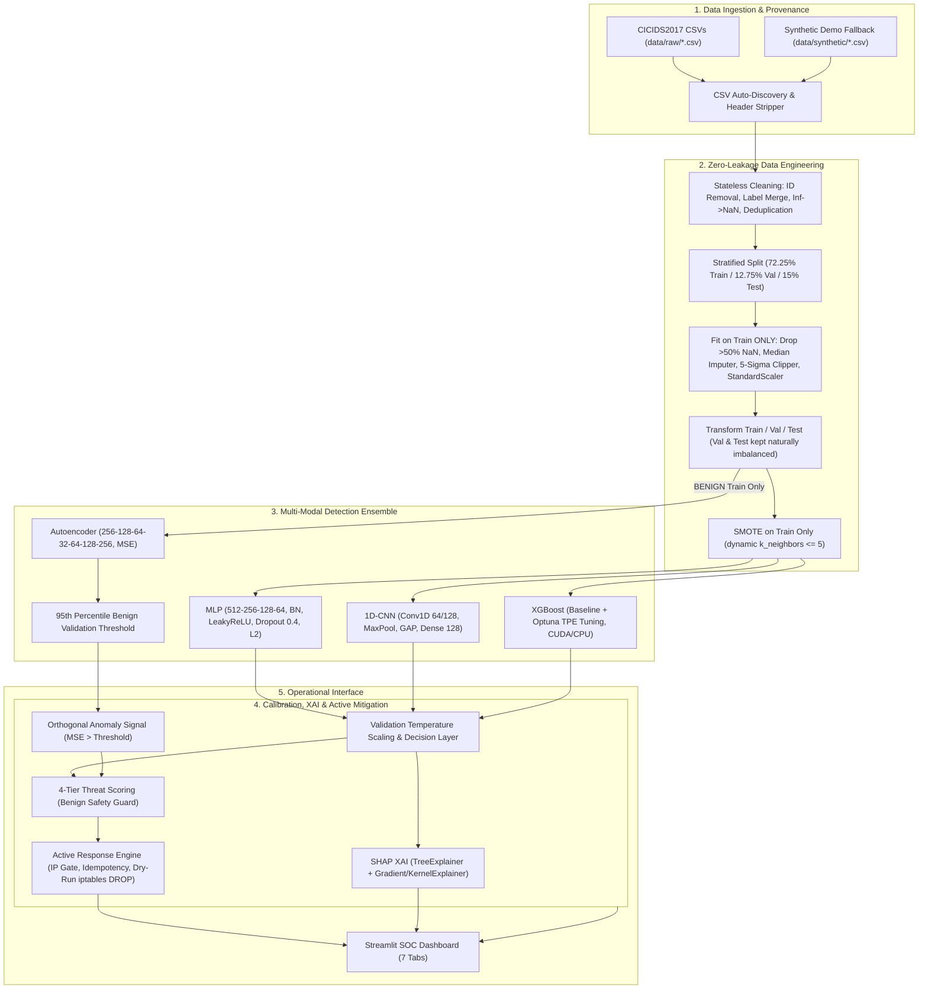
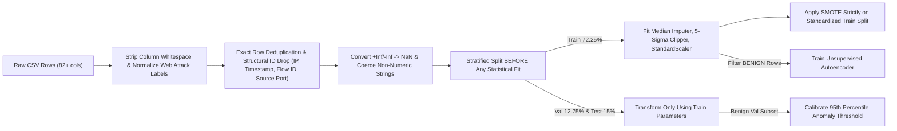

# SMART IDS v3 — System Architecture & Data Engineering Pipeline

## 1. End-to-End Hybrid Architecture Diagram

---

## 2. Leakage-Free Data Engineering Flow

> **Chronological `time_block` Alignment:** Before dropping `Timestamp` from model features, `time_block` evaluation aligns real capture `Timestamp` values from `data/TrafficLabelling/` onto `MachineLearningCVE` flows via [`align_real_timestamps`](../src/data/loader.py) (`flow_telemetry_signature`, `2,830,471 / 2,830,743` = `99.99%` matched; Train `115,669` / Val `37,420` / Test `37,535`, `leakage_checks.passed = True`).

---

## 3. Model Architecture Specifications

| Model | Learning Paradigm | Topology / Hyperparameters | Training Target |
|---|---|---|---|
| **MLP** | Supervised Deep Neural Network (Neural Baseline) | `Input(77) -> [Dense(512/256/128/64, no bias, L2=1e-4) -> BN -> LeakyReLU(0.1) -> Dropout(0.4)] -> Softmax` | Per-model selected strategy (`smote` or `class_weight`/`none`) on multi-class flows (13 CICIDS2017 classes) |
| **1D-CNN** | Supervised Convolutional Network (Neural Baseline) | `Input(77,1) -> Conv1D(64,k=3)x2 + MaxPool(2) + Drop(0.3) -> Conv1D(128,k=3)x2 + GAP + Drop(0.4) -> Dense(128) + Drop(0.3) -> Softmax` | Per-model selected strategy on multi-class flows (13 CICIDS2017 classes) |
| **Autoencoder** | Unsupervised Reconstruction | `Encoder(256->128->64->32) -> Decoder(64->128->256->77 linear)`, MSE loss, `Adam(lr=5e-4)` | **BENIGN training flows only** (zero attack labels) |
| **XGBoost** | Gradient-Boosted Decision Trees (Recommended Production) | Baseline (`300` trees, `depth=6`, `lr=0.1`, `subsample=0.8`, `colsample=0.8`, `hist`) vs CV-std-gated 40-trial Optuna TPE | Per-model selected strategy (`none`) on 13 CICIDS2017 classes |
